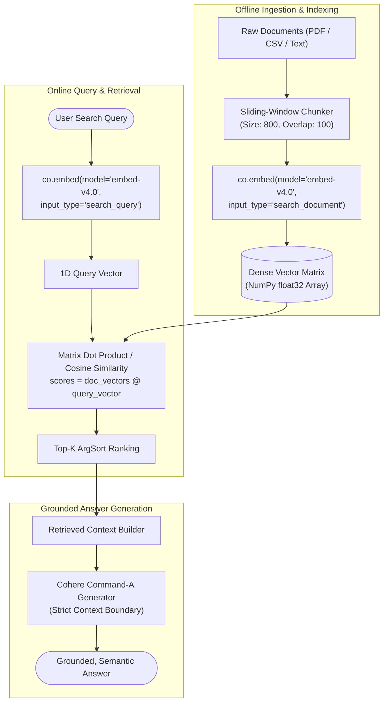

# Semantic Vector RAG Engine

[](https://www.python.org/downloads/)
[](https://cohere.com/embeddings)
[](https://numpy.org/)
[](https://scikit-learn.org/)
[](https://opensource.org/licenses/MIT)

A high-performance **Dense Semantic Vector Search and RAG** laboratory built using **Cohere's state-of-the-art embedding models** (`embed-v4.0`, `embed-english-v3.0`), **NumPy**, and **Scikit-learn**.

This repository showcases the mathematical and architectural core of modern Retrieval-Augmented Generation: generating dense document and query vectors, applying cosine and dot-product similarity metrics, handling sliding-window text chunking, and comparing semantic vs lexical retrieval performance.

---

## Architecture Flow



---

## Pattern Catalog

| Script | Technique | Models Used | Key Mathematical & Engineering Concepts |
|---|---|---|---|
| [`01_basic_dense_embeddings.py`](examples/01_basic_dense_embeddings.py) | **Dense Vector Foundations** | `embed-v4.0` | High-dimensional embeddings, `search_document` vs `search_query` asymmetry, NumPy matrix dot product similarity. |
| [`02_csv_semantic_search.py`](examples/02_csv_semantic_search.py) | **CSV Semantic Search** | `embed-english-v3.0` | Ingesting agile user stories from CSV with Pandas, Scikit-learn `cosine_similarity`, and conceptual matching. |
| [`03_pdf_vector_rag_pipeline.py`](examples/03_pdf_vector_rag_pipeline.py) | **End-to-End Vector RAG** | `embed-v4.0`<br>`command-a-03-2025` | PDF text parsing, sliding-window chunking with boundary overlap, dense vector ranking, and grounded generation. |
| [`04_lexical_vs_semantic_search.py`](examples/04_lexical_vs_semantic_search.py) | **Lexical vs Semantic Benchmark** | `embed-v4.0` | Direct comparison demonstrating why keyword search fails on paraphrased queries while dense vectors succeed. |

---

## Project Structure

```text
LLM-semantic-vector-rag/
├── .env.example                               # Environment configuration template
├── .gitignore                                 # Git ignore patterns
├── LICENSE                                    # MIT License
├── README.md                                  # Repository documentation
├── requirements.txt                           # Production dependencies
├── data/                                      # Sample documents and datasets
│   ├── Agile_Process_Guide_5_Pages.pdf        # PDF guide for sliding-window chunking
│   └── db_userstories.csv                     # Agile user stories for semantic search
└── examples/
    ├── 01_basic_dense_embeddings.py           # Vector embedding mechanics & dot products
    ├── 02_csv_semantic_search.py              # Semantic retrieval over CSV with Scikit-learn
    ├── 03_pdf_vector_rag_pipeline.py          # Complete PDF vector RAG pipeline
    └── 04_lexical_vs_semantic_search.py       # Benchmark: Keyword matching vs Vector search
```

---

## Getting Started

### 1. Prerequisites
- Python 3.10 or higher
- A Cohere API key ([Cohere Dashboard](https://dashboard.cohere.com/api-keys))

### 2. Installation

```bash
# Clone the repository
git clone https://github.com/<your-username>/LLM-semantic-vector-rag.git
cd LLM-semantic-vector-rag

# Create and activate virtual environment
python -m venv .venv

# Windows:
.venv\Scripts\activate
# Linux/macOS:
source .venv/bin/activate

# Install dependencies
pip install -r requirements.txt
```

### 3. Environment Configuration

```bash
cp .env.example .env
```

Add your Cohere API key:
```env
COHERE_API_KEY=your_actual_cohere_api_key_here
```

---

## Running the Examples

### 1. Vector Embedding Foundations
```bash
python examples/01_basic_dense_embeddings.py
```
> Converts FAQ documents into normalized vectors and computes dot products to find the most relevant match.

### 2. CSV Semantic Search
```bash
python examples/02_csv_semantic_search.py
```
> Demonstrates semantic matching on user stories without literal keyword overlap (e.g., query *"As a user I want to save items to buy later"* matches wishlist stories).

### 3. End-to-End PDF Vector RAG Pipeline
```bash
python examples/03_pdf_vector_rag_pipeline.py
```
> Ingests the Agile Process Guide PDF, chunks it with overlap, indexes chunks into a vector store, performs Top-K similarity retrieval, and answers user questions grounded in context.

### 4. Lexical vs Semantic Benchmark
```bash
python examples/04_lexical_vs_semantic_search.py
```
> **Sample Benchmark Output:**
> ```text
> QUERY: "Dealing with sporadic build failures and inconsistent test outcomes"
>
> [1] LEXICAL (Keyword Overlap) Top Match:
>     Overlap Count: 0 | Document: "Selenium WebDriver automates browser interactions."
>     ⚠️ Lexical search completely failed due to zero keyword overlap!
>
> [2] SEMANTIC (embed-v4.0 Dense Vector) Top Match:
>     Similarity Score: 0.6124 | Document: "Flaky tests pass sometimes and fail intermittently."
>     ✅ Vector search correctly understood the underlying semantic concept!
> ```

---

## Key Technical Highlights

1. **Input Type Asymmetry**: Uses Cohere's specialized input types (`search_document` for stored index chunks and `search_query` for user questions), training the embeddings specifically for asymmetric retrieval tasks.
2. **Normalized Dot Products**: Because Cohere embedding vectors are unit-normalized ($L_2$ norm = 1.0), the matrix dot product ($\mathbf{A} \cdot \mathbf{b}$) mathematically equals cosine similarity, eliminating the need for expensive vector norm computations.
3. **Sliding-Window Chunking**: Employs an 800-character window with a 100-character overlap to eliminate semantic boundary cuts across sentences.

---

## License
Distributed under the [MIT License](LICENSE).
